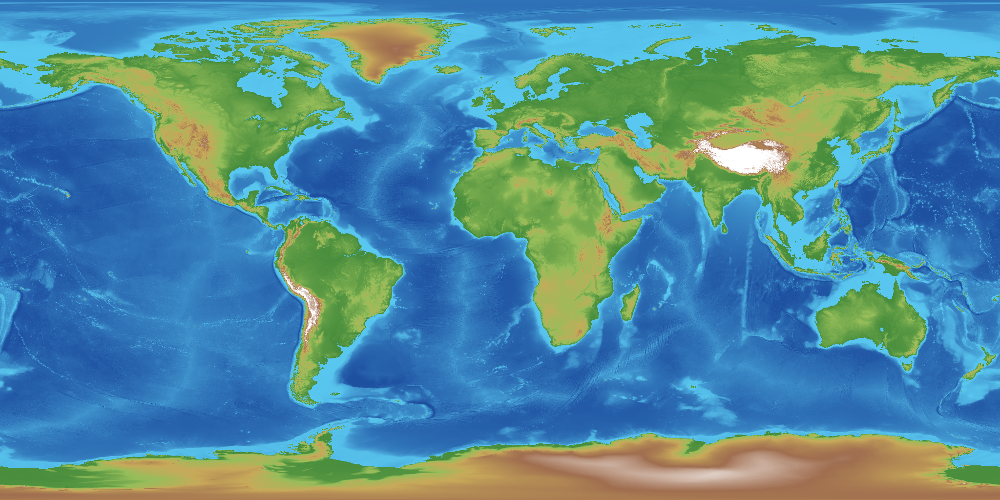

# Earth Data World Gen 1.0.0

**The real Earth as a Minecraft world type.** Real continents, oceans, mountains, rivers, lakes, climates and
forests, built from public geodata. Pick any spot on the globe, pick a scale, spawn there and explore.



## Install

1. Minecraft **26.2**, **Fabric Loader 0.19.5+**, **[Fabric API](https://modrinth.com/mod/fabric-api)**, Java 25.
2. Put [`earthdata-mc26.2-fabric0.19.5-1.0.0.jar`](earthdata-mc26.2-fabric0.19.5-1.0.0.jar) in your `mods` folder (server and clients).
3. Create World → World Type: **Earth**, then **Earth spawn** to choose where you start, the scale, and the
   options of any add-ons you have.

The jar carries a coarse (~5 km) copy of the whole planet, so it works offline. Online, it also streams ~30 m
terrain (Copernicus DEM GLO-30) and ~10 m land cover (ESA WorldCover) for wherever you explore, from their public
AWS buckets, cached in `<instance>/worldbound/cache/` (turn off with `streaming.enabled: false`).

Add-ons: [Earth Fossil Record](../EarthFossilRecord) (dinosaurs and wildlife), [Earth Landmarks](../EarthLandmarks)
(obelisks, travel map, walled cities), [TATV](../TATV). [Earthish World Gen](../EarthishWorldGen) can be installed
alongside.

## What you get
The real planet, from real data. Your hometown, Everest, the Grand Canyon, the Mariana Trench.

- **Real terrain at the scale you choose,** set per world on the spawn screen:
  - **1:3, true proportions (default).** Slopes and valleys at their real steepness. A huge world, about 9.8 million blocks around.
  - **1:5** faster travel, mountains about 1.7× steeper than real.
  - **1:10** epic, about 3.3× steeper.
  - **1:20** quick trips, spiky mountains, thin rivers.
- **A 3,536-block-tall world.** Everest fits at about 3 m per block. The ocean floor is true to 6,000 m, and the deep trenches below that are cut as narrow canyons with sculk, magma vents that pull you down and soul-sand vents that carry you back up. Where the real ocean is deeper than 10,000 m (Challenger Deep and a few others) the water column opens onto the void.
- **Real climate biomes** from the Köppen-Geiger map, and **real land cover**: forests where real forests are, with the right trees at the right density; farmland plains, scrub, deserts, wetlands, glaciers and ice caps. Snow caps start at the real snowline for each range.
- **Real rivers and lakes** at their real widths and levels, including lakes below sea level (the Caspian, the Dead Sea, the Salton Sea). Death Valley, Qattara and the Turpan basin stay dry at their real depth.
- **Coastlines** with cliffs where the coast is steep and beaches where it's flat.
- **Caves and ores measured from the ground under you,** so diamonds sit about 120 blocks down wherever you are, even on a mountain.
- **Structures that fit the land:** villages only on flat ground, with foundations; trial chambers, mineshafts, strongholds and ancient cities buried at reachable depths.
- **Sail around the world.** Crossing 180° in the mid-Pacific puts you on the other side without a loading screen. The poles are the edge of the world.
- **Optional seasons** (`seasons: true`): rain, snow and freezing follow today's date by hemisphere.

## Getting around

- **Spawn picker** on the Create World screen: a flat map or globe; search countries, US states, cities, ZIP codes
  and landmarks, pick a random city or type coordinates.
- **Compass** (**J**): latitude/longitude, heading, altitude, scale and the nearest town. Death messages and
  screenshots record where on Earth they happened.
- `/earth where`, `/earth goto <place>` (cities, countries, states, ZIPs, landmarks; tab-completes), `/earth nearby`,
  `/earth tp <lat> <lon>`, `/earth spawn here`, `/earth sun` (real sun time), `/earth status`, `/earth probe`, `/earthmap`.

## The horizon

WorldBound draws distant terrain itself, straight from the Earth data: out to 32,768 blocks (about 100 km at 1:3) in every direction, coloured like the real blocks, with matching fog, day/night and weather. Nothing extra is generated or saved. With **Distant Horizons** installed, WorldBound feeds DH's distant terrain from the Earth data instead and keeps its own horizon off.

## Optional mods

- **Terralith** and/or **Terrestria** installed: named places and regions use their biomes (Yellowstone, Bryce Canyon, redwood forests, sakura groves, Siberian taiga, the outback and more). Without them everything falls back to vanilla biomes.
- **Terralith ground blocks:** Terralith's licence doesn't allow its code to be redistributed inside another mod, so this compatibility pack isn't included. If you own Terralith you can build it yourself; see [Terralith ground blocks](#terralith-ground-blocks-build-it-yourself).
- **Distant Horizons:** see above.
- **Wild biome mode** (spawn screen): keeps the real planet's shape but covers the land in big patches of every overworld biome you have installed.

## Data packs (optional)

Packs live in `<instance>/worldbound/packs/<name>/` and load automatically. Build them from the free public datasets with the scripts in [`_source/WorldBound/tools`](../_source/WorldBound/tools) (Python 3.11+, `pip install -r tools/requirements.txt`). Each script's header explains where to download its source data.

| Pack | Adds | Build with | Source data |
|---|---|---|---|
| `global` | ~300 m elevation and 1 km climate everywhere | `build_pack.py` / `build_base.py` | GEBCO Grid, Köppen-Geiger |
| `rivers.bin` | rivers with real widths | `build_rivers.py` | HydroRIVERS |
| `lakes`, `lakes_coarse` | lakes and their depths | `build_lakes.py` | HydroLAKES |
| `veg`, `veg_coarse` | forests, fields, ice | `build_veg.py` | Copernicus Global Land Cover |
| `treecover` | forest density | `build_treecover.py` | Copernicus Global Land Cover (tree cover) |
| `glo90` | ~90 m mountains (Alps, Rockies, Himalaya, Andes, Caucasus) | `get_glo90.ps1` then `build_glo90.py` | Copernicus DEM GLO-90 |

Packs you build are derived from those datasets and carry their licences; keep the notices in [ATTRIBUTION.md](../_source/WorldBound/ATTRIBUTION.md) with them if you share them.

## Terralith ground blocks (build it yourself)

With Terralith installed, WorldBound can use Terralith's surface rules (its ground blocks and textures) re-anchored for Earth heights. Because those rules are Terralith's code, you generate the pack from your own copy of Terralith:

```
python3 tools/terralith_compat.py <path/to/Terralith.jar> <earth.json from the engine: data/worldbound/worldgen/noise_settings/earth.json inside META-INF/jars/worldbound-0.8.0.jar> worldbound_terralith
```

Then add the `worldbound_terralith` folder as a data pack when you create the world (Create World → More → Data Packs). Keep it for your own use; don't redistribute it.

## Config

`config/worldbound.json`: `new_world_scale` (3.0), `seasons` (false), `wrap_around` (true), `tree_density` (true),
`trench_void` (true), `horizon.enabled` / `horizon.range_blocks` (true / 32768), `streaming.enabled` (true),
`tile_cache_mb` (512), `debug_commands` (false).

## Credits and licence

Made by [Seth Timmons](https://timmseth.github.io/). Code and own assets: MIT. The geodata in the jar and anything
the tools build stay under their own licences: see [ATTRIBUTION.md](../_source/WorldBound/ATTRIBUTION.md)
(Köppen-Geiger, GEBCO, Copernicus DEM, ESA WorldCover, Copernicus Global Land Cover, HydroRIVERS, HydroLAKES,
GeoNames). Source: [`_source/WorldBound`](../_source/WorldBound) (`mods/earthdata` and the engine in `mods/core`).
