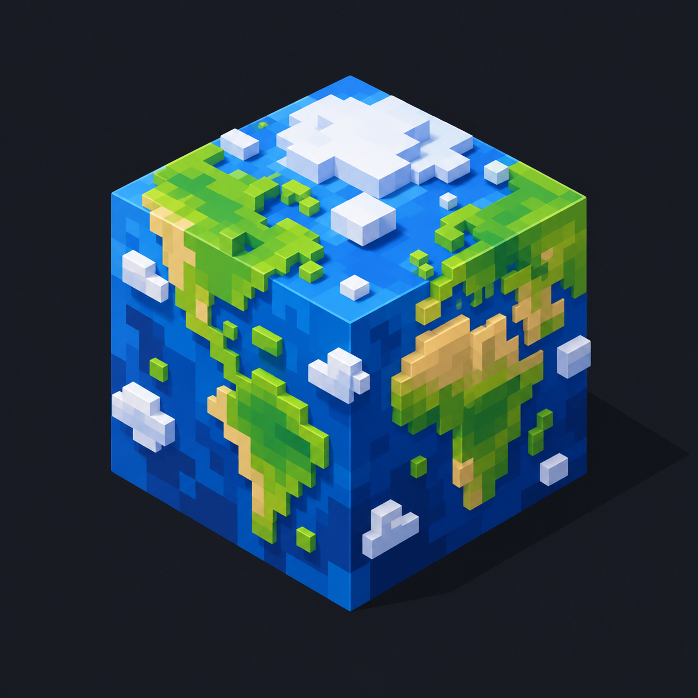

# The WorldBound mods — Minecraft 26.2, Fabric

Real Earth and Earth-like planets as Minecraft world types, the animals that lived on them, landmarks to find,
and a vehicle to get around. Seven mods; install the ones you want.

| Mod | Jar | What it adds | Needs |
|---|---|---|---|
| [Earth Data World Gen](EarthDataWorldGen) | `earthdata-…-1.0.0.jar` | The **Earth** world type: real continents, mountains, rivers, lakes, climates and forests from public geodata; a map to pick your spawn | — |
| [Earthish World Gen](EarthishWorldGen) | `earthish-…-1.0.0.jar` | The **Earthish** world type: a new realistic planet from every seed (tectonics, erosion, climate, rivers) | — |
| [Earth Fossil Record](EarthFossilRecord) | `earth_fossils-…-1.0.0.jar` | 232 real dinosaurs at true size where their fossils were found, tameable raptors, eggs; kangaroos and anacondas | Earth Data World Gen |
| [Earthish Fossil Record](EarthishFossilRecord) | `earthish_fossils-…-1.0.0.jar` | The same animals on Earthish planets, in home ranges where the climate suits them | Earthish World Gen |
| [Earth Landmarks](EarthLandmarks) | `earth_landmarks-…-1.0.0.jar` | Obelisks at 100+ real landmarks, the travel map (K), walled cities | Earth Data World Gen |
| [Earthish Landmarks](EarthishLandmarks) | `earthish_landmarks-…-1.0.0.jar` | Every Earthish planet gets its own named landmarks to discover and travel between | Earthish World Gen |
| [TATV](TATV) | `tatv-…-1.2.0.jar` | The Truly All-Terrain Vehicle: drives, hovers, flies, climbs walls | — (works in any world) |

All of them need **Minecraft 26.2**, **Fabric Loader 0.19.5+**, **[Fabric API](https://modrinth.com/mod/fabric-api)
0.160.0+** and **Java 25**. Install on the server and on every client.

**Everything at once** works: install all seven and you get both world types, each with its own animals and
landmarks.

## How they fit together

- Both world gens carry the shared **WorldBound engine** (`worldbound` 0.8.0) inside their jar: terrain, climate
  biomes, rivers, caves, the compass (J), the built-in distant horizon and Distant Horizons support. Fabric loads one
  copy even with both installed.
- Both Fossil Records carry the shared animals (`fossilrecord` 1.0.0); both Landmarks carry the shared obelisks and
  travel (`worldbound_landmarks` 1.0.0).
- Add-on options appear on the Earth spawn screen (Create World → World Type: Earth → **Earth spawn**):
  dinosaur placement (Accurate / Random), landmark obelisks, city walls. Each world keeps its own choices.
  Earthish worlds take the last choices made there.

## Commands (all under `/earth`)

| Command | From |
|---|---|
| `/earth where` · `status` · `tp <lat> <lon>` · `spawn here` · `spawn <lat> <lon>` · `sun` · `probe` | engine |
| `/earth goto <place>` · `nearby` · `stream` · `/earthmap` | Earth Data World Gen |
| `/earth fauna` · `list` · `where <name>` · `spawn <name>` · `placement [accurate\|random]` | Fossil Record |
| `/earth landmarks` · `city <name>` (Earth) · travel map key **K** | Landmarks |
| `/earthhorizon` · `on` · `off` · `reload` | engine (client) |
| `/tatv` | TATV |

Developer commands (`bench`, `scan`, `seamtest`, `structcheck`, `column`, `lod`, `trees`, `snapshot`,
`fauna selftest|dinotest|dinospeed`, `/earthshot`) are hidden unless `debug_commands` is true in
`config/worldbound.json` (or the game runs with `-Dworldbound.debug=true`).

## Config

- `config/worldbound.json`: the engine and Earth Data (scale, seasons, horizon, streaming, tile cache...).
- `config/fossilrecord.json`: `enabled`, `dinosaurs`, `spawn_scale` (made from the old `fauna` section on first run).

## Source and building

All seven are built from [`_source/WorldBound`](_source/WorldBound); see its [BUILDING.md](_source/WorldBound/BUILDING.md).
History: [CHANGELOG.md](_source/WorldBound/CHANGELOG.md) (WorldBound 0.1.0 – 0.7.7, then the split).

Minecraft is © Mojang Studios / Microsoft. These mods are not official Minecraft products and are not approved by
or associated with Mojang or Microsoft. They contain no Mojang assets.
